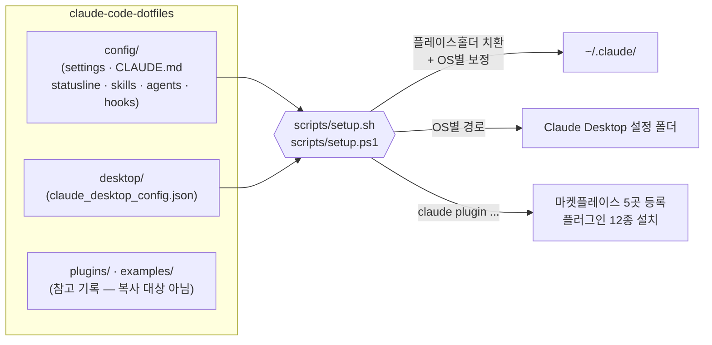

# claude-code-dotfiles

[](https://github.com/jelitz/claude-code-dotfiles/releases)


개인 Claude Code 사용 환경의 공개 백업 저장소입니다.
새 머신에서 환경을 복원하거나, 같은 구성을 참고하려는 다른 사용자가 그대로 활용할 수 있습니다.

> 개인 식별 정보(사용자명·계정 ID·개인 경로·API 식별자)는 모두 `YOUR_USERNAME`, `YOUR_OC_ID` 등의 플레이스홀더로 치환되어 있습니다.

## 목차

- [동작 방식](#동작-방식)
- [빠른 시작](#빠른-시작)
- [버전과 릴리스](#버전과-릴리스)
- [자세히 보기](#자세히-보기) — 파일 구조 · pup · 플러그인 · 스킬 · MCP · Statusline · 설정값 · 수동 설치

---

## 동작 방식



규칙은 세 가지입니다.

| 디렉토리 | 의미 |
|---|---|
| **`config/`** | `~/.claude/` 로 들어가는 것 전부 (= `~/.claude/` 미러) |
| **`desktop/`** | Claude Desktop 앱 설정 (OS별 경로가 다름) |
| **`plugins/` `examples/`** | 참고 기록 — 직접 복사하지 않고 setup 스크립트·문서가 참조 |

---

## 빠른 시작

### 1. 전제 조건

**Git for Windows** (Windows만) — Bash 도구와 statusline 스크립트가 사용.

**Node.js v20+** (옵션) — `@playwright/mcp` 등 npx 기반 MCP 서버 사용 시에만 필요.

**Firecrawl CLI** (옵션) — `web-research` 스킬이 JS 렌더링·차단 페이지를 맡길 때 사용. `npm install -g firecrawl-cli` 후 `firecrawl login --browser` 로 로그인.

### 2. OS별 설치

<details>
<summary><b>🪟 Windows (PowerShell)</b></summary>

```powershell
git clone https://github.com/jelitz/claude-code-dotfiles.git
cd claude-code-dotfiles
.\scripts\setup.ps1
```

- `YOUR_USERNAME` → 실제 사용자명 자동 치환
- Claude Desktop 설정은 `%APPDATA%\Claude\` 에 복사
- `CLAUDE_CODE_GIT_BASH_PATH` 가 실제 Git Bash 경로와 일치하는지 마지막에 확인

</details>

<details>
<summary><b>🍎 macOS / 🐧 Linux</b></summary>

```bash
git clone https://github.com/jelitz/claude-code-dotfiles.git
cd claude-code-dotfiles
bash scripts/setup.sh
```

스크립트가 OS를 감지해 자동으로:
- statusline 경로를 `$HOME` 기준으로 보정
- Windows 전용 env (`CLAUDE_CODE_GIT_BASH_PATH`) 제거
- Claude Desktop 설정을 macOS는 `~/Library/Application Support/Claude/`, Linux는 `~/.config/Claude/` 에 복사

</details>

<details>
<summary><b>🐧 WSL</b></summary>

```bash
git clone https://github.com/jelitz/claude-code-dotfiles.git
cd claude-code-dotfiles
bash scripts/setup.sh
```

- `~/.claude/` 설정은 WSL 내부에 적용 (Linux와 동일하게 보정)
- **Claude Desktop 은 Windows 호스트에서 실행**되므로, Desktop 설정은 호스트 PowerShell에서 `scripts\setup.ps1` 을 실행하거나 `desktop/claude_desktop_config.json` 을 `%APPDATA%\Claude\` 에 직접 복사

</details>

setup 스크립트가 수행하는 일 (5단계):

1. `config/` 의 설정 파일 4종 → `~/.claude/` 복사 (플레이스홀더 치환 + OS 보정)
2. `config/skills/` 의 스킬 20종(직접 관리 8종 + pup 제공 dd-* 11종 + Aside 자동설치 1종)과 `config/agents/` 의 에이전트 49종(직접 관리 1종 + pup 제공 48종) → `~/.claude/`, `config/scripts/hooks`·`config/scripts/lib` → `~/.claude/scripts/`
3. `desktop/claude_desktop_config.json` → OS별 Claude Desktop 경로
4. 마켓플레이스 5곳(+옵션 7곳) 등록
5. 활성 플러그인 12종 설치

나머지 세부 — 파일 구조, pup 내부 동작, 플러그인·스킬·MCP·Statusline·설정값 전체 목록, 스크립트 없이 수동 설치하는 법은 아래 [자세히 보기](#자세히-보기)에 접어두었습니다.

---

## 버전과 릴리스

버전은 스냅샷 날짜(`vYYYY.MM.DD`)입니다. 같은 날 두 번째 릴리스부터는 `.2`, `.3`을 붙입니다. 버전마다 바뀐 내용과 복원할 때 할 일은 [`RELEASE-NOTES.md`](RELEASE-NOTES.md)와 [Releases](https://github.com/jelitz/claude-code-dotfiles/releases)에 있습니다.

특정 버전으로 복원하려면 태그를 체크아웃한 뒤 setup 스크립트를 실행합니다.

```bash
git checkout v2026.10.11
bash scripts/setup.sh        # Windows: .\scripts\setup.ps1
```

<details>
<summary><b>릴리스 절차 (저장소 관리용)</b></summary>

1. `RELEASE-NOTES.md` 맨 위에 `## vYYYY.MM.DD (YYYY-MM-DD)` 절을 추가합니다.
2. `VERSION` 파일과 README 상단의 version 배지를 같은 버전으로 바꿉니다.
3. 커밋을 push한 뒤 태그를 따로 push합니다. 브랜치와 태그를 한 명령으로 push했을 때 태그 이벤트가 발생하지 않아 워크플로가 돌지 않은 적이 있습니다.

   ```bash
   git push origin master
   git tag v2026.10.11
   git push origin v2026.10.11
   ```

태그를 push하면 GitHub Actions(`.github/workflows/release.yml`)가 `scripts/release-notes.sh`로 해당 절을 뽑아 Release를 만듭니다. 태그가 `VERSION` 파일이나 배지와 다르거나 절이 없으면 워크플로가 실패하고 Release는 만들어지지 않습니다.

</details>

---

## 자세히 보기

<details>
<summary><b>📁 파일 구조</b></summary>

```
claude-code-dotfiles/
├── config/                              # ~/.claude/ 미러
│   ├── settings.json                    #   메인 설정 (플러그인·권한 정책)
│   ├── settings.local.json.template     #   머신별 로컬 설정 템플릿
│   ├── CLAUDE.md                        #   전역 AI 지시사항
│   ├── statusline-bash.sh               #   커스텀 2줄 statusline
│   ├── agents/                          #   서브에이전트 49종 (직접 관리 adversarial-reviewer 1 + pup Datadog 48)
│   ├── skills/                          #   스킬 19종 (직접 관리 7 + pup dd-* 11 + Aside 1)
│   │   ├── aside-browser/               #   Aside CLI 설치 시 자동 생성 (벤더 파일)
│   │   ├── browser-automation/
│   │   ├── code-search-exa/
│   │   ├── company-research/
│   │   ├── web-research/                #   웹 검색·fetch 도구 선택표
│   │   ├── web-search-advanced-research-paper/
│   │   ├── web-ux-sweep/                #   실행 중인 웹 앱을 눌러 보며 UX·동작 결함을 찾는 읽기 전용 감사
│   │   └── dd-*/                        #   pup 제공, 11종 (구성 요소 상세 참고)
│   └── scripts/
│       ├── hooks/                       #   PreToolUse·PostToolUse 등 훅 스크립트
│       └── lib/                         #   훅 공용 유틸 (hooks/*.js 가 require)
├── desktop/
│   └── claude_desktop_config.json       # Claude Desktop MCP·환경 설정
├── plugins/                             # 참고 기록 (복사 대상 아님)
│   ├── installed_plugins.json           #   플러그인 목록 (활성/비활성 + 설명)
│   └── known_marketplaces.json          #   마켓플레이스 목록 (실사용/등록만 구분)
├── examples/
│   └── project-permissions.example.json # 프로젝트 종속 권한 예시 (Railway 등)
├── scripts/
│   ├── setup.sh                         # 복원 스크립트 (Git Bash/macOS/Linux/WSL)
│   ├── setup.ps1                        # 복원 스크립트 (Windows PowerShell)
│   └── release-notes.sh                 # RELEASE-NOTES.md 에서 한 버전 절을 추출 (릴리스 워크플로용)
├── tests/hooks/                         # 훅 회귀 테스트 (node --test, 복사 대상 아님)
├── .github/workflows/release.yml        # v* 태그 push 시 GitHub Release 생성
├── RELEASE-NOTES.md                     # 버전별 변경 이력
└── VERSION                              # 현재 버전 (태그·README 배지와 일치)
```

</details>

<details>
<summary><b>🐾 pup — Datadog CLI</b></summary>

Datadog 데이터(모니터·로그·APM·대시보드 등) 조회는 공식 Datadog MCP 플러그인 대신 [pup](https://github.com/DataDog/pup) CLI로 처리합니다. MCP OAuth 재연동이 불안정했던 반면 pup은 자체 OAuth2(PKCE + Dynamic Client Registration) 인증이 안정적으로 동작하고, 바이너리 하나로 200개 이상의 명령을 지원합니다.

#### 설치

```bash
# Homebrew (macOS/Linux)
brew tap datadog-labs/pack
brew install datadog-labs/pack/pup

# 수동 다운로드 (Windows 포함) — 최신 릴리스에서 OS별 바이너리 확인
# https://github.com/DataDog/pup/releases/latest
```

#### 인증

```bash
pup auth login      # OAuth2 브라우저 로그인 (권장, 토큰 자동 갱신)
pup auth status     # 인증 상태 확인
```

#### Claude Code 스킬·에이전트 설치

pup 바이너리는 Claude Code용 스킬·에이전트를 자체 내장하고 있어, 별도 마켓플레이스 등록 없이 아래 한 줄로 설치됩니다. 이 저장소의 `config/skills/dd-*` (11종)와 `config/agents/` 중 `adversarial-reviewer.md` 를 뺀 48종이 이 명령의 결과물이며, `cp -r config/skills/*`·`cp -r config/agents/*` 로 그대로 복원할 수 있습니다.

```bash
pup skills install claude   # ~/.claude/skills/dd-*, ~/.claude/agents/*.md 설치
```

pup 버전을 올린 뒤 같은 명령을 다시 실행하면 스킬·에이전트가 최신 상태로 갱신됩니다.

> ℹ pup은 이 저장소에 커밋하지 않습니다(바이너리이므로 `config/skills/`·`config/agents/` 만 미러 대상). Datadog 관련 작업이 필요 없다면 이 섹션은 건너뛰어도 됩니다. 현재 이 스냅샷을 만든 머신에는 pup이 설치되어 있지 않아 `~/.claude/skills/dd-*` 와 pup 에이전트가 없는 상태이지만, repo 안의 스냅샷은 위 명령으로 언제든 그대로 복원 가능하도록 유지합니다.

</details>

<details open>
<summary><b>🔌 플러그인 — 활성 12종 / 비활성 11종</b></summary>

#### 활성 (`enabled: true`)

| 플러그인 | 마켓플레이스 | 설명 |
|---|---|---|
| [`codex`](https://github.com/openai/codex-plugin-cc) | openai-codex | OpenAI Codex 서브에이전트 (rescue, setup). **job은 항상 `--background` 로 실행** (CLAUDE.md 참고) |
| [`context7`](https://github.com/upstash/context7) | claude-plugins-official | 라이브러리/프레임워크 최신 문서 실시간 조회 (MCP, by Upstash) |
| [`playwright`](https://github.com/microsoft/playwright-mcp) | claude-plugins-official | Playwright 브라우저 자동화 — claude-in-chrome 과 병행 상시 활성화 |
| [`document-skills`](https://github.com/anthropics/skills) | anthropic-agent-skills | Anthropic 공식 문서 작업 (PDF·DOCX·XLSX·PPTX·frontend-design 등) |
| [`cloudflare`](https://github.com/anthropics/claude-plugins-official) | claude-plugins-official | Cloudflare 리소스 관리 (Workers, D1, R2, KV 등) |
| [`insane-search`](https://github.com/fivetaku/insane-search) | gptaku-plugins | 차단된 사이트(X/Reddit/StackOverflow/네이버/쿠팡/LinkedIn 등) 접근용 적응형 웹 검색 — API 키 불필요. SessionStart 훅으로 마켓플레이스 업데이트 알림을 플러그인이 자체 배포(수동 동기화 대상 아님) |
| [`claude-md-management`](https://github.com/anthropics/claude-plugins-official) | claude-plugins-official | CLAUDE.md 작성·정리 헬퍼 |
| [`sentry`](https://github.com/getsentry/sentry-for-ai) | claude-plugins-official | Sentry 이슈 조회·디버깅 스킬과 MCP |
| [`typescript-lsp`](https://github.com/anthropics/claude-plugins-official) | claude-plugins-official | TypeScript 언어 서버(LSP) 연동 — 정의 이동·진단 |
| [`pyright-lsp`](https://github.com/anthropics/claude-plugins-official) | claude-plugins-official | Python(pyright) 언어 서버(LSP) 연동 — 정의 이동·타입 진단 |
| [`firecrawl`](https://docs.firecrawl.dev/sdks/cli) | anthropic-plugin-directory | Firecrawl CLI 기반 스크랩·크롤·검색 스킬. `web-research` 스킬에서 JS 렌더링·차단 페이지를 맡는 2순위 도구. Firecrawl CLI 설치와 로그인이 필요(전제 조건 참고) |
| [`superpowers`](https://github.com/obra/superpowers) | superpowers-marketplace | 브레인스토밍·계획·TDD·디버깅·코드 리뷰 개발 워크플로 스킬. 이 스킬들과 CLAUDE.md가 어긋나면 CLAUDE.md의 "하네스 우선순위" 절을 따름 |

#### 설치되어 있지만 비활성 (`enabled: false`)

| 플러그인 | 마켓플레이스 | 비활성 사유 |
|---|---|---|
| [`ralph-loop`](https://github.com/anthropics/claude-plugins-official) | claude-plugins-official | Ralph Loop 반복 실행 워크플로 — 현재 꺼둠 |
| [`frontend-design`](https://github.com/anthropics/claude-plugins-official) | claude-plugins-official | document-skills의 frontend-design과 중복 |
| [`example-skills`](https://github.com/anthropics/skills) | anthropic-agent-skills | Anthropic 예제 스킬 모음 — 현재 꺼둠 |
| [`security-guidance`](https://github.com/anthropics/claude-plugins-official) | claude-plugins-official | 보안 가이드라인·시큐어 코딩 체크 — 현재 꺼둠 |
| [`code-simplifier`](https://github.com/anthropics/claude-plugins-official) | claude-plugins-official | 최근 변경 코드 단순화·정리 — 현재 꺼둠 |
| [`pr-review-toolkit`](https://github.com/anthropics/claude-plugins-official) | claude-plugins-official | PR 리뷰용 서브에이전트 모음 — 현재 꺼둠 |
| [`code-review`](https://github.com/anthropics/claude-plugins-official) | claude-plugins-official | PR 코드 리뷰 명령 — 현재 꺼둠 |
| [`skill-creator`](https://github.com/anthropics/claude-plugins-official) | claude-plugins-official | 스킬 작성·평가 헬퍼 — 현재 꺼둠 |
| [`stitch-build`·`stitch-design`·`stitch-utilities`](https://github.com/google-labs-code/stitch-skills) | google-labs-code-stitch-skills | Google Stitch 디자인 스킬 3종 — 현재 꺼둠 |

> `superpowers`는 claude-plugins-official 판에서 superpowers-marketplace 판으로 바꿔 설치했습니다. 이전 스냅샷에 있던 `ui-ux-pro-max`, `notion`, `claude-code-setup`, `playground`, `exa-core` 는 현재 설치되어 있지 않습니다. 로컬 폴더를 마켓플레이스로 쓰는 플러그인과 claude.ai에서 동기화되는 플러그인은 이 머신에서만 의미가 있어 기록하지 않습니다.

마켓플레이스는 `plugins/known_marketplaces.json` 에 **실사용(active) / 등록만(registered-only)** 으로 구분 기록되어 있습니다. 등록만 해둔 곳(ui-ux-pro-max-skill, google-labs-code-stitch-skills, exa-skills, Claudest, ecc, agent-browser, claude-for-financial-services)은 setup 스크립트에서 주석 처리되어 있으며 필요 시 해제하면 됩니다.

</details>

<details open>
<summary><b>🧰 사용자 스킬 — 7종</b></summary>

플러그인과 별개로 직접 관리하는 개인 스킬 (`config/skills/` → `~/.claude/skills/`).

| 스킬 | 용도 |
|---|---|
| `code-search-exa` | 코드 예제·API 문법·라이브러리 문서 검색 (GitHub/StackOverflow) — Exa 기반 |
| `company-research` | 기업 정보·경쟁사·시장 리서치 — Exa 기반 |
| `web-search-advanced-research-paper` | 학술 논문·arXiv 검색 (날짜·텍스트 필터 지원) — Exa 기반 |
| `web-research` | 웹 검색·fetch 도구 선택표 — 상황별로 Exa·Firecrawl·WebSearch/WebFetch·insane-search 중 무엇을 쓸지와, 틀리기 쉬운 기본값(Exa fetch 3,000자 제한, Firecrawl 2일 캐시 등)만 담음. 명령 상세는 각 도구 스키마와 firecrawl 플러그인 스킬에 맡김 |
| `browser-automation` | 브라우저 자동화 도구 3종(Aside CLI·claude-in-chrome·Playwright MCP) 선택 기준과 도구별 함정·우회법, 실측 근거는 `evidence.md` (CLAUDE.md에서 이관). Aside 설치 시 자동 생성되는 `aside-browser` 스킬과 함께 동작 |
| `web-ux-sweep` | 실행 중인 웹 앱을 직접 눌러 보며 UX·동작 결함(누른 항목과 열린 화면이 다름, 화면마다 값이 다름, 새로고침하면 선택이 사라짐 등)을 찾는 읽기 전용 감사. 결함 렌즈·제외 목록·증거 규칙만 더하고, `dogfood`(agent-browser)나 `ux-audit`(jezweb/claude-skills) 스킬이 설치돼 있으면 그쪽에 위임하며 없으면 `browser-automation` 기준으로 직접 수행한다. 코드 수정·자동 수정은 하지 않는다 |
| `writing-sdd-blueprints` | 큰 기능의 기획 문서 레이아웃(Kiro 스타일 SDD) — `docs/steering/` 3개와 `docs/specs/{feature}/`의 requirements → design → tasks → implemented, EARS 승인기준, 단계별 승인 게이트, superpowers brainstorming·writing-plans·subagent-driven-development 산출물과의 대응표, 에픽 분할용 roadmap.md 관례. 글로벌 CLAUDE.md의 SDD 절을 `sdd` 스킬로 옮긴 것(v2026.10.11.4)을 v2026.10.12에서 이 이름으로 바꾸고 github/spec-kit 비교로 Assumptions·Complexity Tracking·추가 전용 tasks·roadmap을 보강 |

`dadeumi`(남이 읽을 글을 쓰기 전에 거치는 흐름 — 문서 유형 → 정보 구조 → AI 말투 제거 → 문장 다듬기)는 v2026.10.14부터 이 목록에 없습니다. 플러그인 `dadeumi@dadeumi`로 설치합니다. 마켓플레이스 [jelitz/dadeumi-korean-writing](https://github.com/jelitz/dadeumi-korean-writing)이 `settings.json`의 `extraKnownMarketplaces`에 `autoUpdate: true`로 등록돼 있어 새 세션에서 자동으로 받습니다. 스킬 이름은 `dadeumi:dadeumi`가 되고 `dadeumi-gate` 훅은 이 이름도 인식합니다. 예전 setup이 복사해 둔 `~/.claude/skills/dadeumi/`가 남아 있으면 스킬이 두 벌로 잡히므로 setup 스크립트가 그 경로 하나만 지우고 지운 경로를 출력합니다. setup 스크립트가 파일을 지우는 단계는 이것 하나뿐입니다.

Exa 기반 3종은 [Exa](https://exa.ai) MCP(`https://mcp.exa.ai/mcp`)를 사용하며, 메인 컨텍스트 오염을 막기 위해 frontmatter의 `context: fork` 로 분리된 컨텍스트에서 실행됩니다. 현재는 `settings.json` 의 `skillOverrides` 로 세 스킬 모두 꺼 두었습니다.

> 이전 스냅샷에 있던 디자인 스킬 5종(`designing-premium-web-ui`, `design-taste-frontend`, `high-end-visual-design`, `redesign-existing-projects`, `stitch-design-taste`)은 현재 PC 설정에 없어 저장소에서도 제거했습니다.

직접 관리하는 서브에이전트는 `config/agents/adversarial-reviewer.md` 하나입니다. PR을 열기 전 diff를 새 컨텍스트에서 적대적으로 검토하며, 언제 쓰는지는 CLAUDE.md의 "서브에이전트 위임" 절에 있습니다.

</details>

<details>
<summary><b>🧭 Aside — AI 브라우저 CLI (선택)</b></summary>

[Aside](https://aside.com)는 로그인된 계정 세션을 그대로 쓸 수 있는 서드파티 AI 브라우저 CLI로, 브라우저 자동화 3수단 중 하나입니다(선택 기준은 위 `browser-automation` 스킬).

- `config/skills/aside-browser/` — Aside CLI 설치 시 자동 생성되는 진입점 스킬(`aside guide` 필독 지시). 손으로 작성하지 않으며, Aside를 설치하면 최신 버전으로 재생성됩니다. 저장소에는 복원 편의를 위한 스냅샷만 커밋합니다.
- 설치: `curl -fsSL https://releases.aside.com/install.sh | bash` (macOS/Linux) — Windows는 [aside.com](https://aside.com) 참고.
- Aside 미설치 환경에서는 `browser-automation` 스킬의 나머지 두 도구(claude-in-chrome·Playwright MCP)만 적용됩니다.

</details>

<details open>
<summary><b>🐾 pup 스킬 · 에이전트 — 11 + 48종</b></summary>

[pup](#-pup--datadog-cli) CLI가 자체 내장·설치하는 Datadog 스킬(`config/skills/dd-*`)과 도메인별 서브에이전트(`config/agents/*.md`). 마켓플레이스 등록 없이 `pup skills install claude` 한 줄로 생성되며, 손으로 관리하지 않습니다 — pup 버전을 올릴 때마다 같은 명령으로 갱신.

| 스킬 | 용도 |
|---|---|
| `dd-pup` | pup CLI 기본 — OAuth2 인증, 토큰 갱신 |
| `dd-monitors` | 모니터 생성·수정·mute, 알림 베스트 프랙티스 |
| `dd-logs` | 로그 검색, 파이프라인, 아카이브, 비용 관리 |
| `dd-apm` | 트레이스·서비스·의존성·성능 분석 |
| `dd-debugger` | Live Debugger — 프로덕션 런타임 값 캡처 |
| `dd-docs` | Datadog 공식 문서 검색 |
| `dd-code-generation` | pup CLI 사용 또는 TypeScript/Python/Java/Go/Rust 코드 생성 |
| `dd-file-issue` | pup CLI·플러그인 저장소에 GitHub 이슈 등록 |
| `dd-symdb` | Symbol Database — 서비스 심볼·probe 가능 메서드 검색 |
| `dd-unblock-pr` | 실패한 PR CI 파이프라인 원인 분류(flaky/infra/regression) |
| `dd-triage-flaky-test` | 특정 flaky 테스트 히스토리·원인·조치 추천 |

에이전트 48종은 모니터링·대시보드·시큐리티·인시던트·비용 관리 등 Datadog 도메인별로 세분화되어 있습니다 — 전체 목록은 `config/agents/`(`adversarial-reviewer.md` 제외)를 참고하거나 `pup skills list --type=agent` 로 확인.

</details>

<details>
<summary><b>🪝 훅 — PreToolUse·PostToolUse 5종</b></summary>

`config/scripts/hooks/` (+ 공용 유틸 `config/scripts/lib/`) → `~/.claude/scripts/`. `settings.json`의 `hooks` 절이 이 스크립트를 가리키며, 명령이 없으면 조용히 넘어가는 게 아니라 훅 자체가 발동하지 않으므로 `scripts/hooks`와 `scripts/lib`는 항상 같이 복사합니다.

| 훅 | 이벤트 | 하는 일 |
|---|---|---|
| `suggest-compact.js` | PreToolUse (`Edit`\|`Write`) | 컨텍스트 사용량·도구 호출 수를 추적해 압축 시점을 제안 (자동 압축 대신 전략적 지점에서) |
| `reset-compact-counters.js` | PostCompact | 압축 직후 위 카운터를 리셋 |
| `dadeumi-gate.js` | PreToolUse (Confluence·Jira·Slack 게시 도구, Bash·PowerShell의 `gws`·`gh` 명령) + PostToolUse (`Skill`) | 남이 읽을 글을 올리기 전 `dadeumi` 스킬을 거쳤는지 확인 — 안 거쳤으면 거부하고 사유를 돌려줌. `gh` PR·이슈·릴리스는 스킬 없이 가벼운 체크리스트만 (세션당 1회). 이 파일은 상류 [dadeumi-korean-writing](https://github.com/jelitz/dadeumi-korean-writing) `hooks/dadeumi-gate.js` v1.1.0의 사본이며 둘째 줄 주석(shebang 바로 아래)에 그 태그가 적혀 있음. `ci.yml`이 push·PR마다 `node --check`로 구문을 검사하고, 그 줄을 뺀 나머지를 그 태그의 상류 파일과 `diff`하므로 여기서 고치지 않음. 상류에 새 릴리스가 나오면 사본과 그 줄의 태그를 함께 갱신 |
| `destructive-command-gate.js` | PreToolUse (`Bash`\|`PowerShell`) | git 명령의 `--no-verify`(`git commit -n` 포함)는 거부하고, `rm -rf`·`git push --force`·`git reset --hard`·`git clean -f` 등은 auto 모드에서도 확인을 받게 함. 따옴표·heredoc 안의 글자는 명령으로 보지 않고, `bash -c "..."` 안의 명령은 다시 검사 |
| `py-encoding-check.js` | PostToolUse (`Edit`\|`Write`) | `.py` 파일 저장 직후 `encoding=` 없는 텍스트 I/O 호출(`open()`·`read_text()` 등)을 찾아 Claude에게 알림 (차단하지 않음) |

다섯 훅 모두 실패 시 조용히 통과(`exit 0`)하도록 작성되어 있습니다 — 품질 게이트이지 보안 경계가 아니므로, 훅이 고장 나도 정상 작업을 막지 않습니다.

`destructive-command-gate` 의 회귀 테스트는 `tests/hooks/` 에 있고 `node --test "tests/**/*.test.js"` 로 실행합니다(Node 18 이상).

</details>

<details open>
<summary><b>🔗 MCP 서버</b></summary>

| 서버 | 출처 | 등록 방식 | 설명 |
|---|---|---|---|
| `claude-in-chrome` | [claude.com/chrome](https://claude.com/chrome) | Chrome 확장에서 자동 | 브라우저 자동화 3수단(Aside CLI·claude-in-chrome·Playwright MCP) 중 하나 — 내 Chrome 탭을 보며 스텝별로 조작할 때. 선택 기준은 `browser-automation` 스킬 |
| `context7` | [upstash/context7](https://github.com/upstash/context7) | 플러그인이 자동 등록 | `context7@claude-plugins-official` 활성 시 자동 |
| Slack · Exa | [claude.com/connectors](https://claude.com/connectors) | claude.ai 커넥터 | claude.ai 계정 연결로 제공 (이 저장소 설정과 무관, 계정에서 별도 연결). Exa 커넥터가 `web_fetch_exa` 를 제공 |
| `exa` | [exa.ai](https://exa.ai/docs/get-started/exa-mcp) | `claude mcp add` (user 스코프) | 웹 검색 1순위. 필터 검색 도구 `web_search_advanced_exa` 는 기본 비활성이라 tools 파라미터로 켬: `claude mcp add --transport http -s user exa "https://mcp.exa.ai/mcp?tools=web_search_exa,web_search_advanced_exa"` |
| `playwright` | [microsoft/playwright-mcp](https://github.com/microsoft/playwright-mcp) | Claude Desktop (`desktop/claude_desktop_config.json`) | `npx @playwright/mcp@latest` — Desktop 전용 |
| `shadcn` | [ui.shadcn.com](https://ui.shadcn.com) | `claude mcp add` (user 스코프) | shadcn/ui 컴포넌트 레지스트리 조회: `claude mcp add -s user shadcn -- npx shadcn@latest mcp` |

</details>

<details>
<summary><b>📊 Statusline — 커스텀 2줄 상태 표시</b></summary>

터미널 하단에 세션 정보를 두 줄로 표시합니다 (`config/statusline-bash.sh`).

```
⎇ main │ ◈ Opus 4.8 │ effort: high │ ⚖ advisor: (unset) │ v2.1.225
ctx ████░░░░ 45% │ $0.23 │ 5h ██░░░░░░ 23% ↻ 1h30m │ 7d █░░░░░░░ 13%
```

**Row 1 — identity**

| 항목 | 설명 |
|---|---|
| `⎇ branch` | 현재 git 브랜치 (cyan) |
| `◈ model` | 모델명 (blue, "Claude " 접두어 생략) |
| `effort: <lvl>` | 작업 노력 수준 (magenta) |
| `⚖ advisor: <model>` | `settings.json` 의 `advisorModel` 값 (yellow); 미설정 시 `(unset)` (dim) |
| `v버전` | Claude Code 버전 (dim) |

**Row 2 — usage**

| 항목 | 설명 |
|---|---|
| `ctx bar %` | 컨텍스트 윈도우 사용률 (50%↑ 노랑, 80%↑ 빨강) |
| `$cost` | 세션 누적 비용 ($1↑ 노랑, $5↑ 빨강) |
| `5h bar % ↻ left` | 5시간 rate limit + 리셋까지 남은 시간 |
| `7d bar %` | 7일 rate limit |

**구현 메모**
- advisor 값은 stdin JSON에 없어 스크립트가 `~/.claude/settings.json` 을 직접 읽음 (현재 `advisorModel` 미설정 → `(unset)` 표시)
- 줄 분리는 `printf '%s\n'` 두 번 호출 (Claude Code 다중 줄 statusline 사양)
- 활성화: `settings.json` → `statusLine.command` (Git Bash 식 경로 — setup.sh 가 OS에 맞게 치환)

</details>

<details>
<summary><b>⚙️ 주요 설정값 (settings.json)</b></summary>

| 키 | 값 | 설명 |
|---|---|---|
| `language` | `Korean` | 응답 언어 |
| `model` | `opus` | 기본 모델 고정 (세션마다 `/model` 로 변경 가능) |
| `effortLevel` | `high` | 기본 작업 노력 수준 (low/medium/high/xhigh/max) |
| `modelSettings` | 모델별 effort | Opus·Fable 계열은 `xhigh`, Sonnet 계열은 `medium` |
| `skillOverrides` | 스킬별 `off` | Exa 기반 사용자 스킬 3종을 끔 |
| `promptSuggestionEnabled` | `false` | 프롬프트 제안 끔 |
| `permissions.defaultMode` | `auto` | 안전한 작업은 자동 승인 |
| `worktree.baseRef` | `fresh` | 워크트리 생성 시 기준 ref |
| `autoDreamEnabled` | `true` | 세션 종료 시 자동 메모리 추출 |
| `teammateMode` | `auto` | Agent Teams 팀원 실행 방식 자동 선택 |
| `skillListingBudgetFraction` | `0.05` | 스킬 목록이 차지하는 컨텍스트 비율 상한 |
| `autoUpdatesChannel` | `latest` | 최신 채널로 자동 업데이트 |
| `skipWorkflowUsageWarning` | `true` | 워크플로 사용 경고(비용 안내 등) 생략 |
| `remoteControlAtStartup` | `true` | 시작 시 원격 제어 활성화 |
| `inputNeededNotifEnabled` / `agentPushNotifEnabled` | `true` | 입력 필요·에이전트 완료 푸시 알림 |
| `env.CLAUDE_CODE_GIT_BASH_PATH` | Git Bash 경로 | Bash 도구용 (**Windows 전용** — macOS/Linux 설치 시 자동 제거) |
| `env.ENABLE_TOOL_SEARCH` | `true` | 지연 로드 도구 검색 활성화 |
| `env.CLAUDE_CODE_EXPERIMENTAL_AGENT_TEAMS` | `1` | 멀티 에이전트 팀 기능 활성화 |
| `env.PYTHONUTF8` / `env.PYTHONIOENCODING` | `1` / `utf-8` | Windows(cp949) 환경에서 Python 한글 입출력이 깨지지 않게 함 |
| `env.CLAUDE_CODE_SUBAGENT_MODEL` | `sonnet` | `model`을 지정하지 않은 서브에이전트의 기본 모델. frontmatter·호출 파라미터가 우선하고 내장 Explore·Plan은 영향 없음 |

#### 전역 권한 정책

전역 `settings.json` 의 `permissions.allow` 에는 **범용 권한 2개만** 유지합니다 (브라우저 탭 컨텍스트 조회, Get-FileHash). Railway 배포 운영 등 **프로젝트 종속 권한은 해당 프로젝트의 `.claude/settings.json` 에 두는 것이 원칙**이며, 실제 사용하던 목록은 [`examples/project-permissions.example.json`](examples/project-permissions.example.json) 에 참고용으로 보존되어 있습니다.

</details>

<details>
<summary><b>🛠 수동 설치</b> (스크립트 없이 직접 설치하기)</summary>

```bash
# 1. 설정 파일 복사 (YOUR_USERNAME 치환 필요)
cp config/settings.json ~/.claude/settings.json
cp config/settings.local.json.template ~/.claude/settings.local.json
cp config/CLAUDE.md ~/.claude/
cp config/statusline-bash.sh ~/.claude/ && chmod +x ~/.claude/statusline-bash.sh
mkdir -p ~/.claude/skills && cp -r config/skills/* ~/.claude/skills/
mkdir -p ~/.claude/agents && cp -r config/agents/* ~/.claude/agents/
mkdir -p ~/.claude/scripts/hooks ~/.claude/scripts/lib
cp -r config/scripts/hooks/* ~/.claude/scripts/hooks/ && cp -r config/scripts/lib/* ~/.claude/scripts/lib/

# macOS/Linux 추가 보정 (statusline 경로 + Windows 전용 env 제거)
#   settings.json 의 "/c/Users/YOUR_USERNAME" → "$HOME" 으로 치환
#   "CLAUDE_CODE_GIT_BASH_PATH" 줄 삭제 (env 블록 첫 항목이라 줄 삭제만으로 JSON 유효)

# 2. Claude Desktop MCP 설정 (OS별 경로)
cp desktop/claude_desktop_config.json "$APPDATA/Claude/claude_desktop_config.json"                      # Windows (Git Bash)
cp desktop/claude_desktop_config.json "$HOME/Library/Application Support/Claude/claude_desktop_config.json"  # macOS
cp desktop/claude_desktop_config.json "$HOME/.config/Claude/claude_desktop_config.json"                 # Linux

# 3. 마켓플레이스 등록 (anthropic-plugin-directory 는 내장, 나머지는 인자 하나로 추가)
claude plugin marketplace add anthropics/claude-plugins-official
claude plugin marketplace add anthropics/skills
claude plugin marketplace add openai/codex-plugin-cc
claude plugin marketplace add https://github.com/fivetaku/gptaku_plugins.git
claude plugin marketplace add obra/superpowers-marketplace

# 4. 플러그인 설치 (활성화 대상)
claude plugin install codex@openai-codex
claude plugin install context7@claude-plugins-official
claude plugin install playwright@claude-plugins-official
claude plugin install document-skills@anthropic-agent-skills
claude plugin install cloudflare@claude-plugins-official
claude plugin install claude-md-management@claude-plugins-official
claude plugin install sentry@claude-plugins-official
claude plugin install typescript-lsp@claude-plugins-official
claude plugin install pyright-lsp@claude-plugins-official
claude plugin install insane-search@gptaku-plugins
claude plugin install firecrawl@anthropic-plugin-directory
claude plugin install superpowers@superpowers-marketplace

# 5. Exa MCP (user 스코프) — web-research 스킬의 1순위 검색 도구
claude mcp add --transport http -s user exa "https://mcp.exa.ai/mcp?tools=web_search_exa,web_search_advanced_exa"
```

</details>

---

## License

This project is licensed under the MIT License - see the [LICENSE](LICENSE) file for details.
